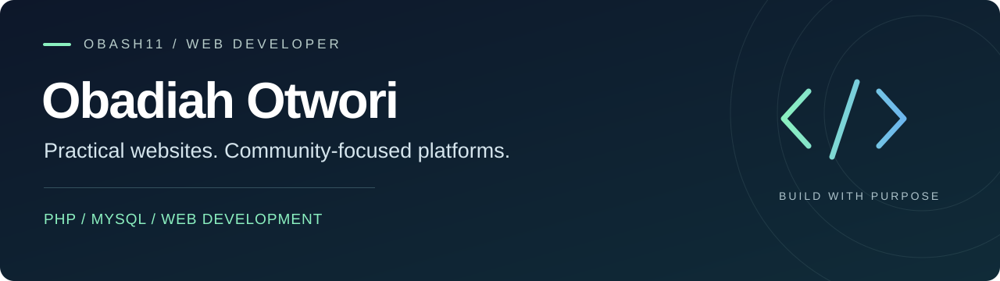
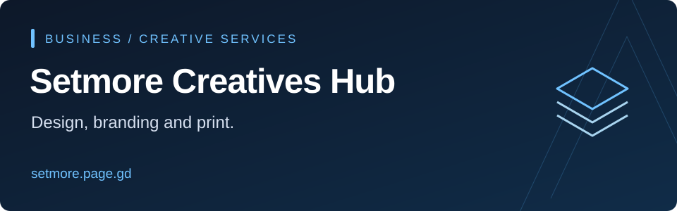
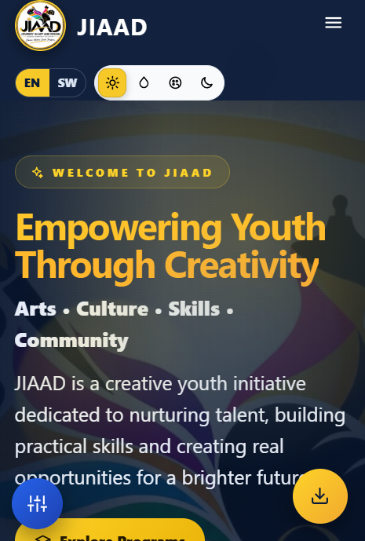
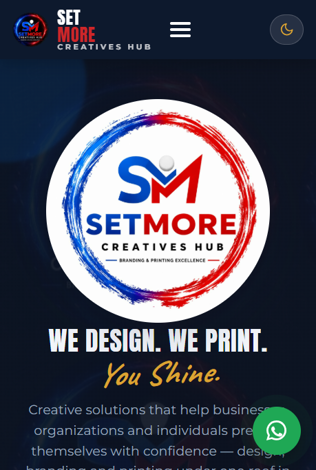

  

  <a href="https://jiaadfoundation.co.ke"><strong>JIAAD Foundation</strong></a>
  &nbsp; · &nbsp;
  <a href="https://setmore.page.gd"><strong>Setmore Creatives Hub</strong></a>

  <a href="#featured-projects">Projects</a> · <a href="#project-comparison">Compare</a> · <a href="#live-site-preview-gallery">Screenshots</a> · <a href="#what-i-work-with">Tools</a> · <a href="#feedback-and-collaboration">Connect</a>

## Building for people, businesses and communities

I'm **Obadiah Otwori**, a web developer working with **PHP and MySQL**. I build practical websites that help people find information, discover opportunities and connect with the services they need.

My featured work brings together two interests: **community-focused digital platforms** and **clear, engaging business websites**.

## Featured projects

<table>
<tr>
<td width="50%" valign="top">

<h3>JIAAD Foundation</h3>

A creative youth portal for programme discovery, student access and community opportunities in Mukuru.

<strong>Highlights:</strong> programme discovery, registration entry points and a certificate-verification page.

<a href="https://jiaadfoundation.co.ke"><strong>Visit live website</strong></a> · <a href="https://github.com/obash11/jiaad-foundation">Explore showcase</a>

</td>
<td width="50%" valign="top">

<h3>Setmore Creatives Hub</h3>

A Nairobi branding and printing business website connecting prospective clients with creative services and work samples.

<strong>Highlights:</strong> service catalogue, work portfolio, quote-enquiry and WhatsApp contact links.

<a href="https://setmore.page.gd"><strong>Visit live website</strong></a> · <a href="https://github.com/obash11/setmore-creatives-hub">Explore showcase</a>

</td>
</tr>
</table>

## Project comparison

| | JIAAD Foundation | Setmore Creatives Hub |
| --- | --- | --- |
| Focus | Creative learning and community opportunities | Branding, design and printing services |
| Audience | Young people and the Mukuru community | Businesses, institutions and individuals |
| Key journey | Discover a programme → explore registration | Explore services → view work → enquire |
| Public experience | Programme discovery, student sign-in entry point and certificate verification page | Service catalogue, portfolio and quote/contact entry points |
| Live website | [jiaadfoundation.co.ke](https://jiaadfoundation.co.ke) | [setmore.page.gd](https://setmore.page.gd) |

## Live-site preview gallery

<strong>Open real mobile screenshots of both projects</strong>

 
<table>
<tr>
<th>JIAAD Foundation</th>
<th>Setmore Creatives Hub</th>
</tr>
<tr>
<td align="center"></td>
<td align="center"></td>
</tr>
</table>

Captured from the public websites on 12 November 2026. Visit the live sites for the current experience.

## What I work with

| Area | Tools and technologies |
| --- | --- |
| Back end and data | PHP, MySQL |
| Local development | XAMPP |
| Project presentation | GitHub, documentation and live website showcases |

## How I approach a project

- Start with the people using it and the task they need to complete.
- Keep information, navigation and calls to action clear.
- Bring the experience together from local development to a live website.

## Feedback and collaboration

Have an idea for improving one of these projects? Use its structured GitHub feedback forms:

- [JIAAD Foundation feedback](https://github.com/obash11/jiaad-foundation/issues/new/choose)
- [Setmore Creatives Hub feedback](https://github.com/obash11/setmore-creatives-hub/issues/new/choose)
- [Profile feedback or a project idea](https://github.com/obash11/obash11/issues/new/choose)

For programme applications or printing quotes, use the relevant **live website**, not GitHub issues. Please keep private contact details, passwords and student/customer information out of public reports.

<strong>About these showcases</strong>

Each featured repository includes a project case study, a public feature guide, suggested demo routes, screenshots, FAQs and contribution guidance. They document live work without distributing the production application or its data.

The repositories also include a dependency-free documentation checker. Run `node .github/scripts/check-showcase.cjs` in a downloaded repository to check local links, asset references and the permitted file types.

[Contribution guide](CONTRIBUTING.md) · [Privacy and security reporting](SECURITY.md)

---

**Explore the work:** [JIAAD Foundation](https://jiaadfoundation.co.ke) · [Setmore Creatives Hub](https://setmore.page.gd)

The featured repositories document the projects and link to their live websites. They do not contain production credentials, databases or private user records.
